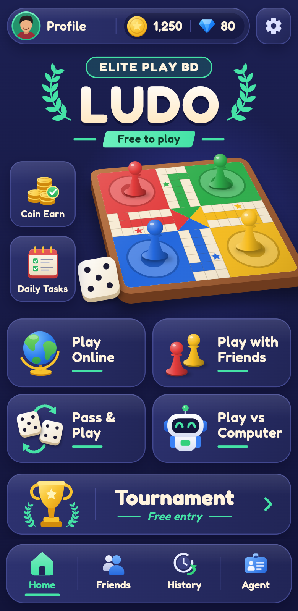

# Elite Play BD Ludo

Flutter home page for the Elite Play BD Ludo app.

- The board, pawns, match background and icons (`assets/images`) are supplied artwork. The dice, player docks and effects are drawn in code.
- The page is laid out on a 390pt design canvas and scaled to the device width.
- Static art sits behind `RepaintBoundary`, so the idle board animation only moves a cached layer.

## Play

- **Pass & Play** — 2 to 4 players on one phone.
- **Play vs Computer** — you against 1 to 3 bots.
- Pick the entry coins for the table; the header shows the prize pool and room id.

Rules: roll a 6 to leave the yard; a 6, a capture or reaching home earns
another roll; three 6s in a row lose the turn; start cells and star cells are
safe; an exact roll is needed to get home. The match continues until one
player is left, so players finish 1st, 2nd, 3rd and get a crown on their yard.

Each player has 5 lives and 20 seconds per turn. Running out of time costs a
life and the turn is played automatically; at 0 lives the player leaves.

Quick messages (emoji and phrases) show as bubbles on the player's panel.
The Voice button is only a mic toggle for now: real voice chat, coins that
are actually spent or won, and Play Online / Play with Friends / Tournament
all need a server and are not built yet.

## Snake & Ladder

Snakes & Ladders on a 10x10 board, opened from its tile or banner.

- Pass & Play (2 to 4 players) or Play vs Computer (1 to 3 bots).
- The ladders and snakes are placed afresh for every match (6 ladders, 7 snakes, never crossing), using the supplied board, ladder and snake artwork.
- Everyone starts on square 1 and races to 100. A ladder's foot takes you
  up, a snake's head takes you down. A 6 earns another roll, and the last
  roll must land exactly on 100.
- Same table as Ludo: 5 lives, a 20 second turn clock, finishing places,
  entry coins, quick messages.

## Carrom

Top-down carrom with real collisions, cushions and pockets.

- Slide the striker along your baseline, pull back anywhere on the board to
  aim and set the power, let go to shoot.
- 1 vs Computer, 1 vs 1, 2 vs 2 with computer players, or 2 vs 2 on one
  phone (partners sit opposite and share a colour). In same-phone games the
  board turns to face whoever is playing.
- Pocket your own coin to shoot again. Pocketing the striker is a foul (a
  coin comes back). The Queen must be covered by pocketing one of your coins
  with the next shot, and nobody can finish until the Queen is claimed.
  First side to pocket all nine coins wins.

## 16 Ghuti

Sholo Guti on the 37-point board (a 5x5 grid with a triangle at each end).

- 1 vs Computer or 1 vs 1 on one phone. Each side starts with 16 pieces;
  the middle row is empty.
- Tap one of your pieces, then a lit point: green is a step along a line to
  an empty neighbour, red is a jump straight over an enemy piece to the
  empty point beyond, which takes it.
- After a capture the same piece may keep jumping, or you can end the turn.
- Take every enemy piece, or leave the other side with no move, to win.
  Eighty moves in a row without a capture is a draw.

## Car Racing

A 3D-style circuit race seen from above and behind your car, using the
art in `assets/images/race/` (cars, trees, flowers, fences, signs, obstacles).
It is not full 3D: the cars and scenery are flat pictures on a projected road.

- Pick your car (red, blue, green or gold) on the setup sheet.
- Race 2, 3 or 4 cars (you against 1–3 computer cars) over 1, 2, 3 or 5
  laps. The track has curves, hills, a start/finish arch, trees, bushes, flowers,
  rocks, fences, flags, signs and street lamps beside the road.
- Hold GAS to go and ◀ / ▶ to steer. BRAKE slows the car (the brake
  lights come on) and, once stopped, backs it up. NITRO gives a burst of
  speed; the bar refills slowly, or at once from a nitro bottle. Top speed
  is 150 km/h, more on nitro. Keys: arrows or WASD, space for nitro.
- Coins on the road are counted in the HUD. Cones, barrels, tyres,
  barriers and hay bales cost speed and are knocked away. Grass is slow,
  and a fence along the verge keeps the car where it can steer back on.
  Cars bump each other.
- The pause button offers resume, restart and quit.
- Exhaust smoke, nitro jets, grass thrown up off-road, sparks on hits and
  tail lights that glow when braking.
- A 3-2-1 start light, live position, lap, time and speed, and a results
  card at the end.

## Fruit Cut

Swipe across the wooden board to cut the fruit thrown up from below. The
24 fruits are pictures in `assets/images/fruit/` (whole, and two halves
that tumble apart when cut).

- Classic: three lives; every fruit that falls uncut costs one, cutting a
  green poison flask costs one, and cutting a bomb ends the game.
- 60 Seconds: cut as much as you can; a bomb costs 10 points and poison 5.
- Vs Computer: you and up to three computer players (Ruby, Jade, Amber)
  cut on the same board for 60 seconds; each has its own blade colour,
  reacts a little slower or faster, and sometimes hits a bomb. A
  scoreboard shows everyone, and the results rank all players.
- Pass & Play: 2 to 4 people take 60-second turns on one phone, then the
  scores are ranked.
- One point per fruit; three or more in one swipe is a combo worth extra.
- A chef's knife follows your finger, leaving a glowing slash in the
  blade's colour (silver, fire or neon). Juice splashes and
  stains the board for a few seconds, bombs flash and shake the screen,
  and the best score of the session is kept per mode.

## Poker (Texas Hold'em)

No-limit Texas Hold'em at a table of two to five: you and computer
players, with play chips only. The table is the supplied picture, laid
out sideways, so the phone turns to landscape while the table is open
and back to upright when you leave.

- Pick a table, from blinds 10/20 up to the 500 Crore table (blinds 2.5
  Crore / 5 Crore), and how many sit at it. The account starts with 10
  lakh crore play chips. A
  buy-in screen then asks how many chips to bring, from 20 to 200 big
  blinds (100 by default), with a slider and MIN / 100 BB / MAX; it shows
  what stays in your account. You play with exactly what you brought.
- Your account and your table chips are both shown at the table. Leaving
  returns the table chips to the account. If you bust you can buy in
  again from the account, or take free chips when it is empty. Chips last
  while the app is open.
- The dealer button moves round each hand; the two seats after it post
  the small and big blind. Everyone gets two cards, then betting rounds
  before the flop, on the flop (three cards), the turn and the river.
- Your profile sits at the bottom with your two cards below it and your
  chips under them; the others' cards peek from the corner of their
  profiles. A player who folds turns grey with FOLD across the profile;
  their cards go, and yours stay in front of you in grey.
- On your turn the buttons sit beside your seat: FOLD on the left, CHECK
  or CALL and RAISE on the right. RAISE opens a panel with a slider and
  quick amounts (minimum, half pot, pot, all in). A ring round the seat
  counts down 20 seconds; if yours runs out you check, or fold to a bet.
- Chips are shown as stacks coloured by value. Each bet sits beside a
  plaque naming the move (blind, call, bet, raise, all in) in its colour.
- Every move has its own sound slot (deal, card, check, call, raise, all
  in, fold, your turn, last-seconds tick, win, lose, chips). Until a
  recording named `assets/sounds/poker<Name>.wav` is added, each borrows
  an existing sound; see `_standIns` in `lib/game/sounds.dart`.
- The best five cards from your two and the five on the table win:
  straight flush, four of a kind, full house, flush, straight, three of
  a kind, two pair, pair, high card. Ties split the pot, and a player
  who is all in for less can only win the side pot they matched.
- The computer players have different temperaments: they fold weak
  cards, call with draws, bet and raise strong hands, bluff now and
  then, and get a new stack when they go broke.
